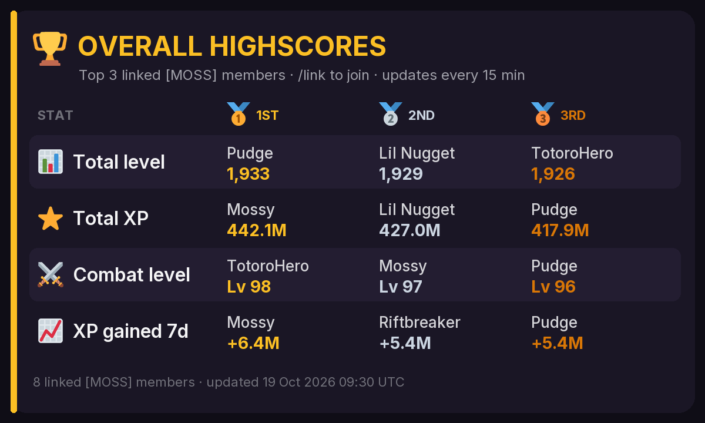
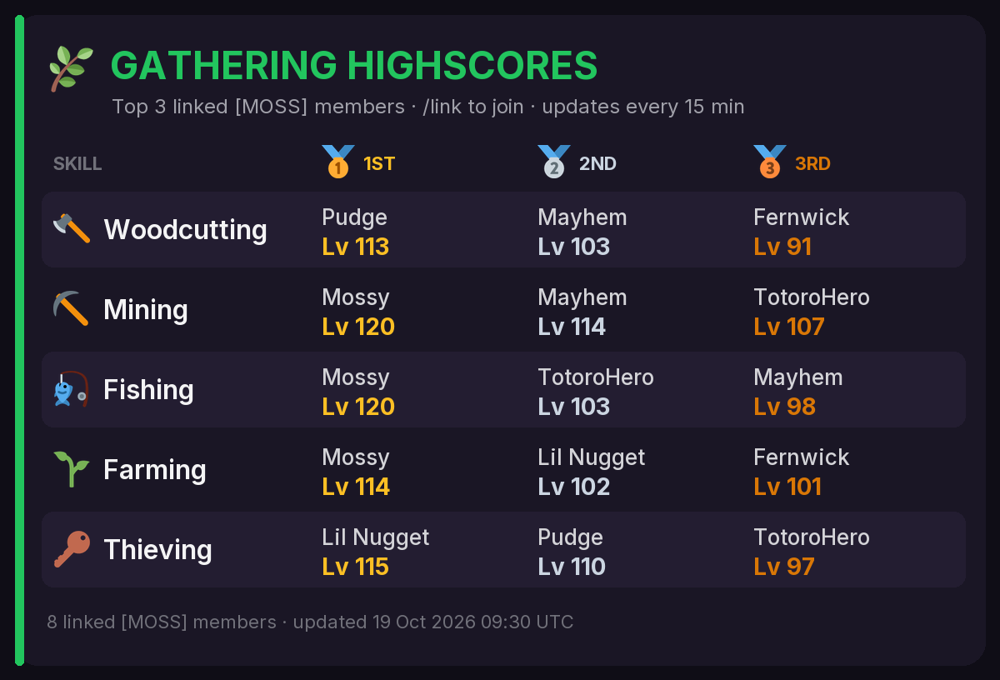
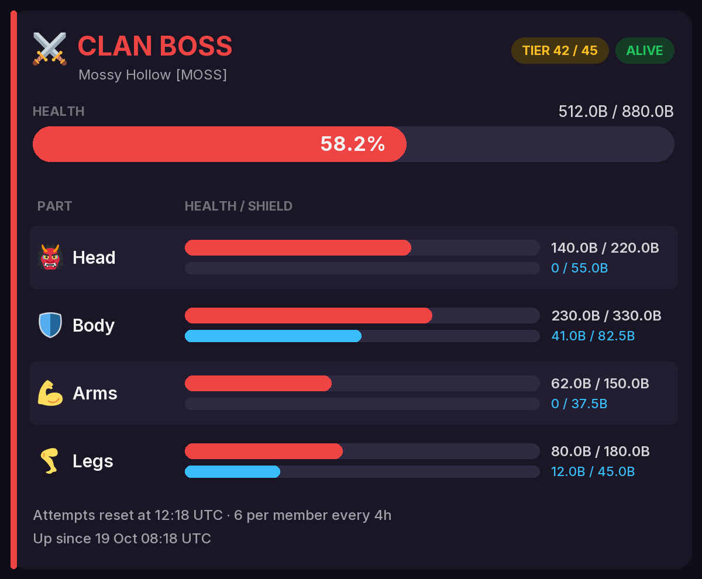
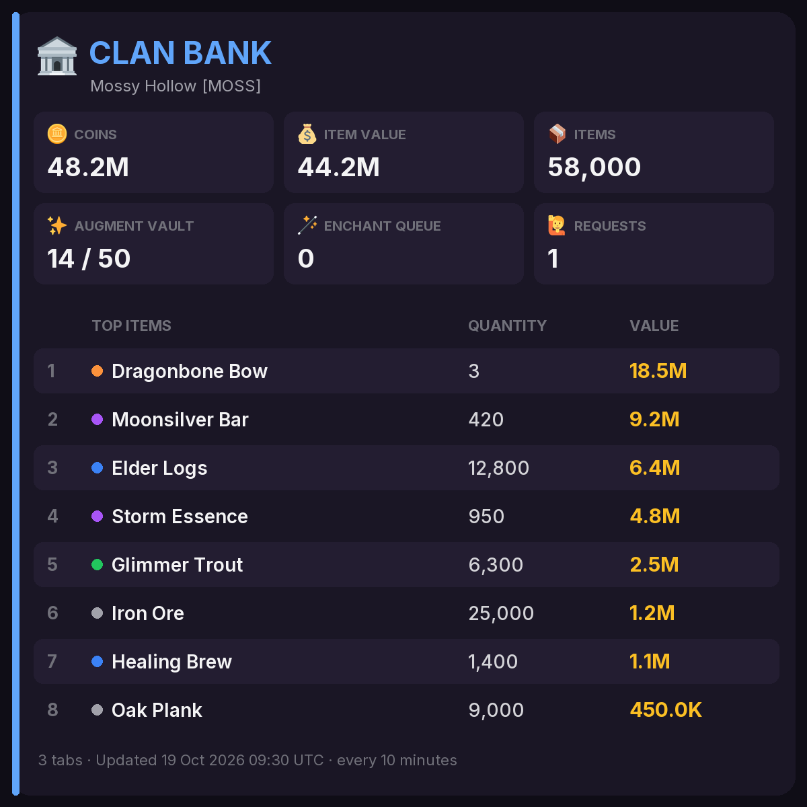
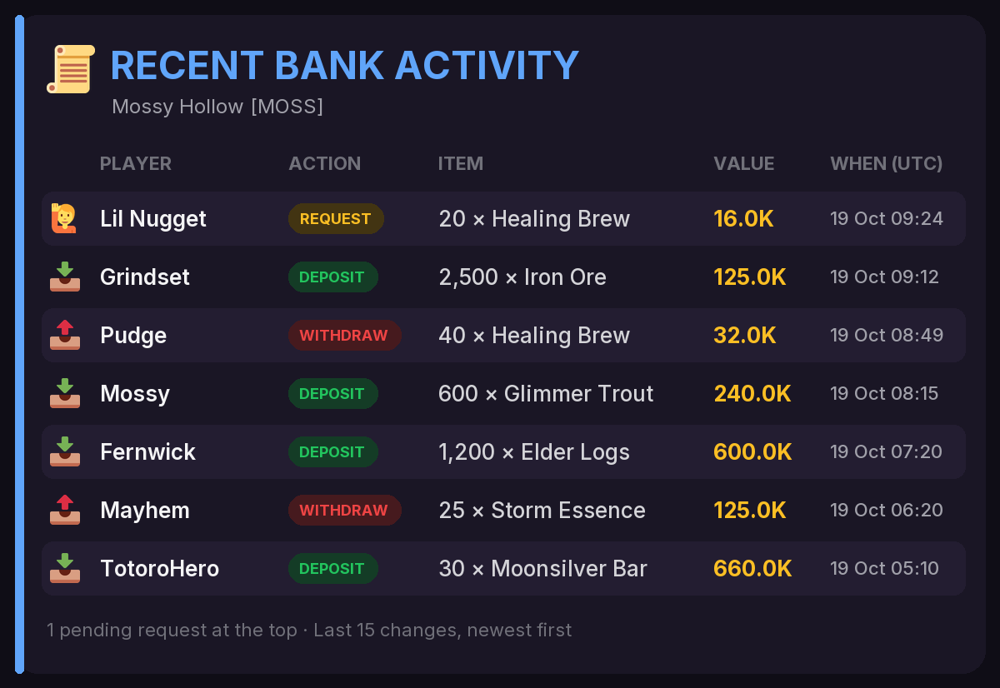
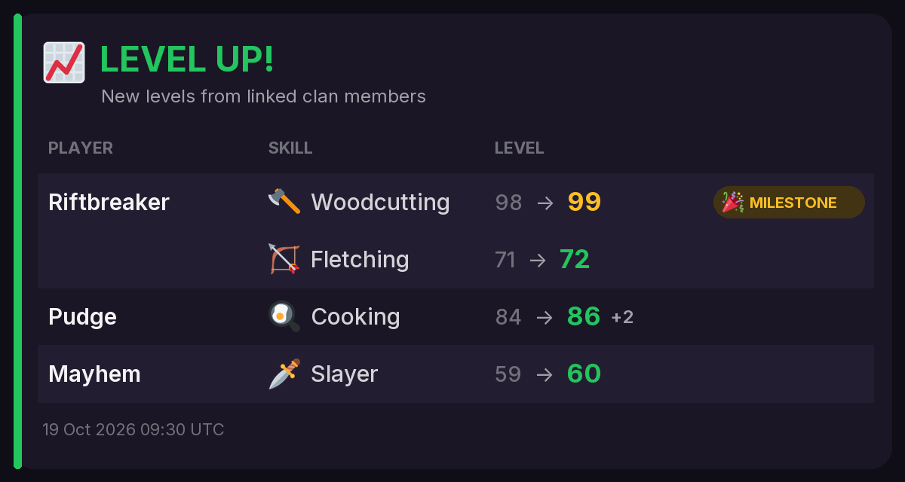
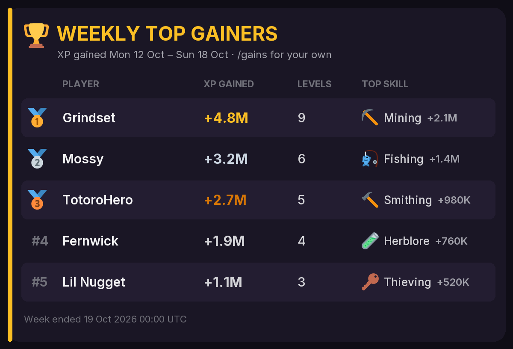
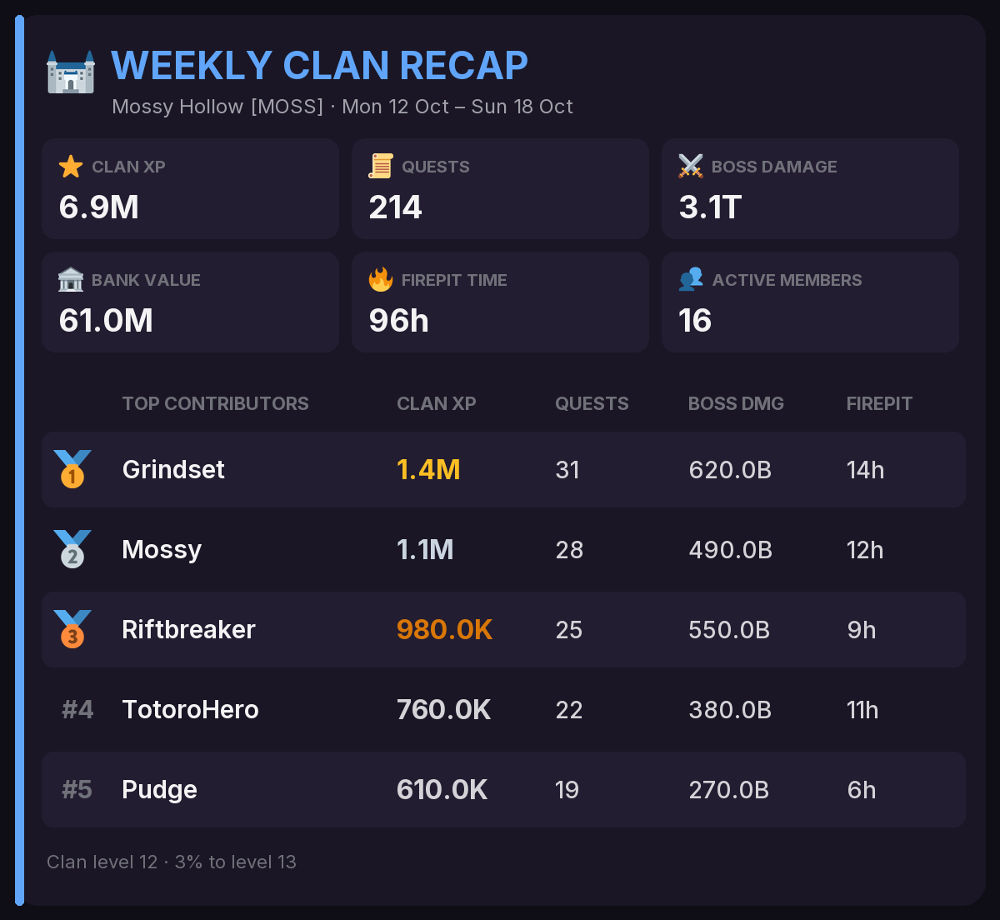
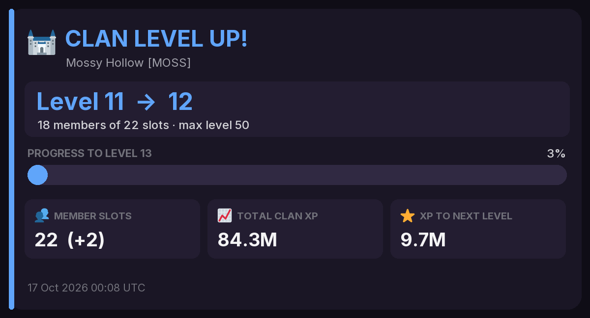
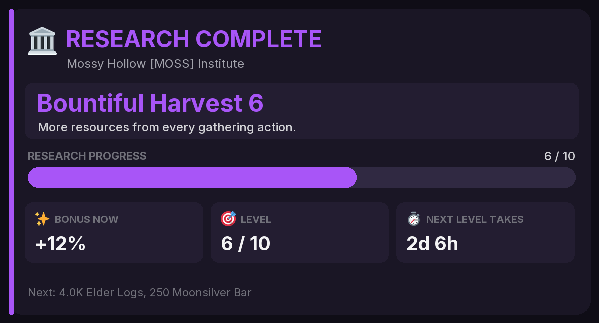

# Koruxa Discord Bot

A self-hosted Discord bot for [Koruxa](https://koruxa.com) clans. It reads the Koruxa Player API to give your server:

- **Clan highscores**: four live image boards (Overall, Combat, Gathering, Artisan) of your linked clan members, edited in place.
- **Clan feed**: skill level-ups, clan level-ups, Institute research, and weekly recaps / top gainers.
- **Clan boss alerts**: a live boss card with HP and shields, plus a role ping when a new boss spawns or attempts refresh.
- **Clan bank**: a live bank summary and the latest deposits, withdrawals and requests.
- **World boss alerts**: role pings for world boss events.
- **Personal tools**: profile, XP/h rates with what-if boosts, mastery route planning, XP gains, clan-bank budget.

Each server runs its own copy of the bot with its own Discord bot account. Nothing is shared between installs.

## Screenshots

Every image below is drawn by the bot itself. The clan (*Mossy Hollow [MOSS]*), players and numbers are made up; regenerate them with [`scripts/demo_images.py`](scripts/demo_images.py).

| Clan highscores | Skill boards (Combat, Gathering, Artisan) |
|---|---|
|  |  |
| **Clan boss** (live HP, shields, attempts) | **Clan bank** |
|  |  |
| **Bank activity** (deposits, withdrawals, requests) | **Level-ups** (clan feed) |
|  |  |
| **Weekly top gainers** | **Weekly clan recap** |
|  |  |
| **Clan level-up** | **Institute research** |
|  |  |

---

## Contents

1. [Requirements](#requirements)
2. [Create the Discord bot](#1-create-the-discord-bot)
3. [Download and configure](#2-download-and-configure)
4. [Start the bot](#3-start-the-bot)
5. [Set up your server](#4-set-up-your-server)
6. [Commands](#commands)
7. [Configuration reference](#configuration-reference)
8. [Updating, logs and backups](#updating-logs-and-backups)
9. [Security and privacy](#security-and-privacy)
10. [Troubleshooting](#troubleshooting)

---

## Requirements

- A machine that stays on (a home server, Raspberry Pi 4/5, or a small VPS) with
  [Docker](https://docs.docker.com/engine/install/) and the Docker Compose plugin.
- About 256 MB of RAM. The bot needs **no open ports**: it only makes outgoing connections to Discord and koruxa.com.
- Admin rights (**Manage Server**) on the Discord server you want to add it to.
- For the clan features: your clan's API token from the game (see [Clan token](#clan-token)).

You can also run it without Docker (Python 3.12+, `pip install -r requirements.txt`, `python -m bot`), but Docker is the supported way.

---

## 1. Create the Discord bot

1. Go to the [Discord Developer Portal](https://discord.com/developers/applications) and click **New Application**. Give it a name (e.g. *Koruxa Bot*).
2. Open the **Bot** tab:
   - Click **Reset Token**, then copy the token. This is your `DISCORD_TOKEN`. **Keep it secret**: anyone with it controls your bot.
   - Leave all three **Privileged Gateway Intents** turned **off**. The bot doesn't need them.
   - Optional: turn off **Public Bot** so only you can invite it.
3. Invite the bot to your server. Open this link, replacing `YOUR_APPLICATION_ID` with the **Application ID** from the **General Information** tab:

   ```
   https://discord.com/oauth2/authorize?client_id=YOUR_APPLICATION_ID&scope=bot+applications.commands&permissions=268684288
   ```

   That grants exactly what the bot uses:

   | Permission | Why |
   |---|---|
   | View Channels, Send Messages, Read Message History | Post and update its alert messages |
   | Embed Links, Attach Files | Embeds and the highscore/boss images |
   | Mention @everyone, @here and All Roles | Ping the alert roles (they're created non-mentionable so members can't spam them) |
   | Manage Roles | Create the alert roles and hand them out from the role panel |

4. Get your **server ID** for `GUILD_ID`: in Discord, enable **User Settings → Advanced → Developer Mode**, then right-click your server icon → **Copy Server ID**.

---

## 2. Download and configure

```bash
git clone <this repository's URL> koruxa-bot
cd koruxa-bot
cp .env.example .env
chmod 600 .env
```

Generate an encryption key (the bot encrypts every Koruxa token it stores with it):

```bash
python3 -c "import base64,os;print(base64.urlsafe_b64encode(os.urandom(32)).decode())"
```

Edit `.env` and fill in at least:

```ini
DISCORD_TOKEN=your-bot-token
ENCRYPTION_KEY=the-key-you-just-generated
GUILD_ID=your-server-id
```

> ⚠️ **Back up `ENCRYPTION_KEY`.** If it's lost or changed, the stored tokens can't be read and everyone has to `/link` again.

All other settings are optional; see the [configuration reference](#configuration-reference).

---

## 3. Start the bot

```bash
docker compose up -d --build
docker compose logs -f bot
```

You should see `Synced N command(s)` and `Logged in as …`. Press `Ctrl+C` to stop following the logs (the bot keeps running).

The container runs as a non-root user with a read-only filesystem, no Linux capabilities and a 256 MB memory limit. Its only writable storage is the `data/` folder (the SQLite database).

---

## 4. Set up your server

Do these in Discord, as a server admin. Commands marked *(admin)* are hidden from members who lack **Manage Server**.

### a. Make some channels

A suggested layout (any names work):

| Channel | Used for |
|---|---|
| `#koruxa-bot` | Role panel, help menu, and where members run commands |
| `#highscores` | Clan Highscores |
| `#clan-feed` | Clan Feed |
| `#boss-alerts` | World Boss and Clan Boss |
| `#clan-bank` | Clan Bank |

Make sure the bot's role can view and post in them.

### b. Point each feature at a channel

Run `/setchannel` once per feature:

```
/setchannel feature:Clan Highscores channel:#highscores
/setchannel feature:Clan Feed       channel:#clan-feed
/setchannel feature:Clan Boss       channel:#boss-alerts
/setchannel feature:World Boss      channel:#boss-alerts
/setchannel feature:Clan Bank       channel:#clan-bank
/setchannel feature:Help Menu       channel:#koruxa-bot
```

Run `/setchannel` with no channel to turn a feature off. `/alerts` shows the current setup and any permission problems.

### c. Post the role panel

```
/rolepanel channel:#koruxa-bot
```

This creates the **World Boss** and **Clan Boss** roles (or reuses existing roles with those names) and posts buttons members click to opt in or out of pings. If it warns that a role is above the bot's role, drag the bot's role higher in **Server Settings → Roles**.

Check everything with `/testalert feature:Clan Boss`.

### d. Link the clan token

<a id="clan-token"></a>
The clan features (bank, boss, clan XP, Institute) need your **clan's** API token. It's a different token from a personal one: it's managed by the clan in-game, in the clan's settings.

```
/link-clan
```

A pop-up asks for the token. The bot checks it with Koruxa, stores it encrypted, and replies with the clan's name. From then on:

- The highscores, clan feed and `/topgains` only count linked characters **in that clan**.
- Clan boss, bank, XP and Institute updates start within a minute.

Running `/link-clan` again with another token replaces it. `/clear-clan` removes it (clan features stop; highscores then show every linked character). Only admins of the `GUILD_ID` server can change it.

### e. Members link their characters

Each member runs:

```
/link
```

and pastes their **Player API token** (in game: **Settings → Account → API access → New token**, starts with `kxu_`). Up to 4 characters per Discord user. Tokens are stored encrypted and only read that player's own data. `/unlink` removes a character and deletes its token.

Linked characters in the clan appear on the highscores at the next refresh (every 15 minutes by default).

---

## Commands

### 👤 Your account

| Command | What it does |
|---|---|
| `/link` | Link a Koruxa character with its Player API token (up to 4) |
| `/unlink [character]` | Remove a linked character and delete its stored token |
| `/characters` | List your linked characters |
| `/profile [character] [public]` | Show your Koruxa profile |
| `/budget [character]` | Your clan-bank withdrawal budget for today (needs the *clan bank* block enabled on your token in game) |

### 🧮 Tools

| Command | What it does |
|---|---|
| `/rates <skill> [sort] [wells] [buffs] [brew] [extra_speed] [extra_xp] [cape] [character] [public]` | Your best XP per hour for a skill, with optional what-if boosts. `sort`: XP or mastery XP per hour. `cape`: count your best owned cape instead of the one you're wearing |
| `/mastery <unlock> <skill> [character] [public]` | Quickest route to the total mastery that unlocks a skill's expert actions (3,000 / 3,500 / 4,000, or all three) |

### 📈 Progress

| Command | What it does |
|---|---|
| `/gains [period] [character] [public]` | XP gained today, this week or this month (your characters or a clanmate's) |
| `/topgains [period] [public]` | The server's top XP gainers |

### 🏰 Clan *(needs the clan token)*

| Command | What it does |
|---|---|
| `/clan [public]` | Clan level and this week's top XP contributors |
| `/clanbank [public]` | What's in the clan bank |
| `/institute [public]` | Clan Institute research levels and what's next |
| `/link-clan` *(admin)* | Set the clan's API token |
| `/clear-clan` *(admin)* | Remove the clan API token |

### 🌀 World Boss

| Command | What it does |
|---|---|
| `/worldboss` | Show the current World Boss event |

### 🛠️ Server setup *(admin)*

| Command | What it does |
|---|---|
| `/setchannel <feature> [channel]` | Choose the channel for a type of alert (leave `channel` empty to turn it off) |
| `/rolepanel [channel]` | Post the buttons members use to pick their alert roles |
| `/alerts` | Show where each type of alert goes |
| `/testalert <feature>` | Post a test alert, with its role ping |

### General

| Command | What it does |
|---|---|
| `/help` | List the commands and their options (admins also see the admin ones) |
| `/ping` | Check that the bot is alive |

Most read-only commands answer privately; add `public:True` to show the answer to the channel.

---

## Configuration reference

All settings live in `.env` (see `.env.example`). Restart after changing them: `docker compose up -d`.

| Setting | Required | Default | Meaning |
|---|---|---|---|
| `DISCORD_TOKEN` | ✅ | | Your bot's token from the Developer Portal |
| `ENCRYPTION_KEY` | ✅ | | Fernet key that encrypts stored Koruxa tokens. Back it up |
| `GUILD_ID` | | *(empty)* | Your server ID. Commands appear there instantly, and only its admins can change the clan token. Empty = commands sync globally (can take a while to appear the first time) |
| `CLAN_TAG` | | *(empty)* | Only used when **no** clan token is linked: limit highscores/feed/`/topgains` to this clan tag. Empty = every linked character |
| `HIGHSCORES_REFRESH_MINUTES` | | `15` | How often each linked player's profile is re-fetched (minimum 5) |
| `WEEKLY_RESET_DAY` / `WEEKLY_RESET_HOUR` | | `Monday` / `0` | When the game's week resets (UTC); weekly recaps post then |
| `HIGHSCORES_DEMO` | | *(empty)* | `1` adds 8 made-up players to preview full boards (only while no clan token is linked) |
| `LOG_LEVEL` | | `INFO` | `DEBUG`, `INFO` or `WARNING` |

### API limits

Koruxa allows **240 requests/hour per personal token** and **120/hour per clan token**. The bot paces itself under both:

- Highscores: one `/me` per linked character per refresh (4/hour each at the 15-minute default).
- Clan token: about 85/hour (boss every minute, XP every 5, bank and Institute every 10). If other tools use the same clan token, you can hit the limit; the bot then backs off and logs `429`.

---

## Updating, logs and backups

```bash
git pull                      # get the latest code
docker compose up -d --build  # rebuild and restart
docker compose logs -f bot    # follow the logs
docker compose down           # stop the bot
```

Everything the bot remembers is in `data/bot.db`. To back up, copy `data/` **and** your `.env` (without `ENCRYPTION_KEY` the stored tokens are unreadable).

---

## Security and privacy

- **Never commit `.env` or `data/`.** Both are in `.gitignore`. `.env` holds your bot token and encryption key; `data/bot.db` holds the (encrypted) Koruxa tokens.
- Koruxa tokens, personal and clan, are encrypted at rest with `ENCRYPTION_KEY` and never written to the logs (logs show a short fingerprint instead).
- Tokens are entered through pop-up forms, so they never appear in chat or command history.
- If a token is revoked in game, the bot notices, unlinks it and DMs the owner.
- If your Discord bot token leaks, reset it in the Developer Portal. If the clan token leaks, rotate it in game and `/link-clan` the new one.

---

## Troubleshooting

| Problem | Fix |
|---|---|
| Commands don't show up | Set `GUILD_ID` for instant sync, restart, and reload Discord (`Ctrl+R`). Check the logs say `Synced N command(s)` |
| `ENCRYPTION_KEY is not a valid Fernet key` | Generate one with the command in [step 2](#2-download-and-configure) |
| Alerts don't post | Run `/alerts`; it lists missing channel permissions |
| Role pings don't notify | The bot needs **Mention @everyone, @here and All Roles** in that channel |
| Role panel can't assign a role | Move the bot's role above the alert roles in **Server Settings → Roles** |
| Highscores are empty | Members must `/link`, and only characters in the linked clan count. The footer shows how many linked clan members it found |
| `429 … backing off` in the logs | A token hit its hourly API limit (often a clan token shared with other tools). It recovers on its own |
| "Koruxa rejected that token" on `/link-clan` | That's a personal `kxu_` token; use the clan's token |

---

## License

The bot's code is public domain under [The Unlicense](LICENSE): use, copy, change, sell or share it however you like, no credit needed.

The bundled font and emoji images in `assets/` keep their own licences (see below); Twemoji's CC-BY 4.0 asks that you credit Twitter if you redistribute them.

## Credits

- Game data from the Koruxa Player API. This is a fan-made bot, not affiliated with Koruxa.
- Fonts and emoji images: see [`assets/README.md`](assets/README.md) (Inter, SIL OFL 1.1; Twemoji, CC-BY 4.0).
